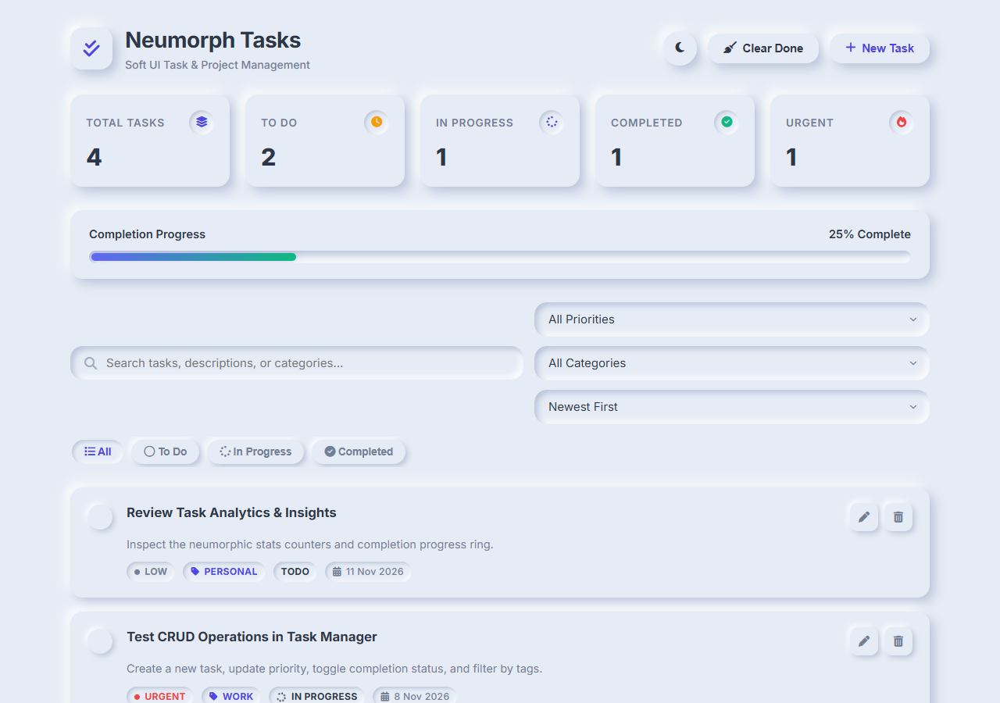
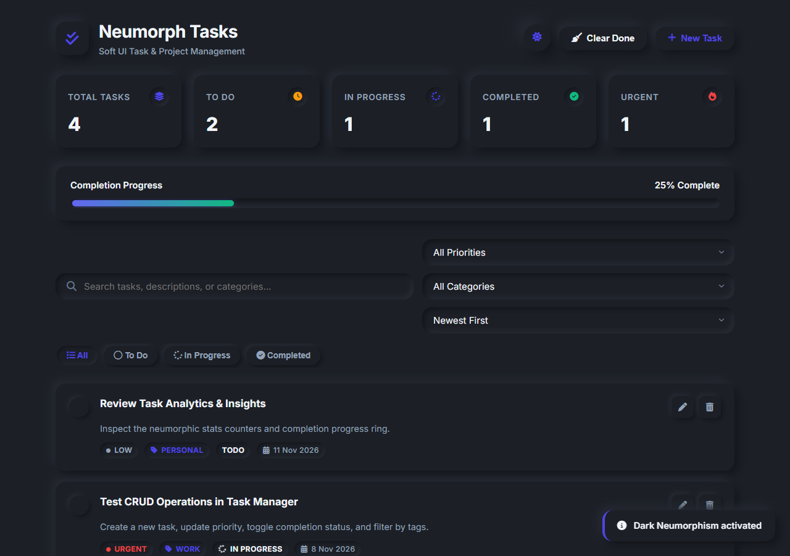
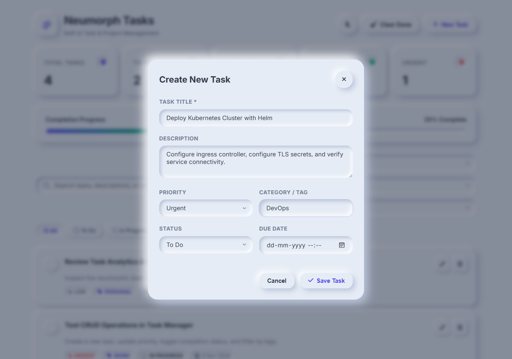
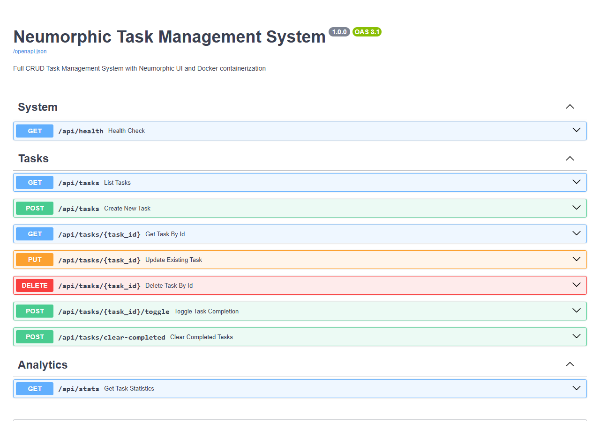

# 🌟 Neumorphic Task Management System

A modern, full-stack **Task Management System** featuring **complete CRUD operations**, containerized with **Docker & Docker Compose**, and crafted with an authentic **Neumorphism (Soft UI)** design system in both **Light** and **Dark** modes.


---

## ✨ Features

- **Full CRUD Operations**:
  - **Create**: Add tasks with title, detailed notes, priority (`Low`, `Medium`, `High`, `Urgent`), custom category tag, and due date.
  - **Read**: Live search, filtering by status (`All`, `To Do`, `In Progress`, `Completed`), category filter, priority filter, and multi-option sorting (`Newest`, `Oldest`, `Due Date`, `Priority`).
  - **Update**: Edit any field in a sleek modal dialog; quick one-click toggle for task completion status.
  - **Delete**: Delete individual tasks or bulk-remove all completed tasks with "Clear Done".
- **🎨 Neumorphic Design System (Soft UI)**:
  - **Extruded Elements**: Soft dual shadows that simulate light falling on clean extruded surfaces.
  - **Debossed Inputs**: Inset wells for inputs, dropdowns, and search bars that feel pressed into the surface.
  - **Tactile Switches & Buttons**: Convex / pressed micro-interactions with elevation feedback.
  - **Dual Neumorphic Themes**: Seamless toggle between **Light Neumorphism** (`#e6ecf5`) and **Dark Neumorphism** (`#1c1f26`).
  - **Dynamic Metrics**: Neumorphic stat counters and a real-time completion progress bar.
- **🐳 Docker & Docker Compose**:
  - Production-ready `Dockerfile` with Python 3.11 slim.
  - One-command orchestration via `docker-compose.yml`.
  - Named Docker volume (`task_data`) for persistent SQLite storage across container rebuilds.
  - Built-in container health check endpoint (`/api/health`).

---

## 📸 Screenshots Showcase

| Neumorphic Light Mode | Neumorphic Dark Mode |
|---|---|
|  |  |

| Create Task Modal Dialog | Interactive Swagger API Docs |
|---|---|
|  |  |

> 📖 **Full System Documentation**: See [`docs/DOCUMENTATION.md`](docs/DOCUMENTATION.md) for architectural diagrams, CSS tokens, database dictionary, and API specs.
- **⚡ High Performance REST API**:
  - Powered by **FastAPI** with automatic interactive API documentation at `/docs` (Swagger UI).
  - Robust schema validation with **Pydantic v2**.
  - Persistent relational storage with **SQLAlchemy 2.0** & **SQLite**.

---

## 📁 Project Structure

```
task-manager/
├── app/
│   ├── __init__.py          # App package initialization
│   ├── database.py          # SQLite engine & session management
│   ├── models.py            # SQLAlchemy Task model
│   ├── schemas.py           # Pydantic validation schemas
│   ├── crud.py              # Database query logic & default seeds
│   ├── main.py              # FastAPI routes, health check & static server
│   └── static/
│       ├── index.html       # Neumorphic single page application
│       ├── css/
│       │   └── style.css    # Dual-shadow Neumorphic design system
│       └── js/
│           └── app.js       # Client CRUD, filtering, stats, & theme logic
├── data/                    # Persistent database storage (mounted in Docker)
├── Dockerfile               # Container build instructions
├── docker-compose.yml       # Multi-container orchestration & volumes
├── requirements.txt         # Python dependencies
├── run.bat                  # One-click Windows runner
├── run.sh                   # One-click Unix / macOS runner
├── .dockerignore            # Docker build ignore rules
├── .gitignore               # Git ignore rules
└── README.md                # Documentation
```

---

## 🚀 Quick Start with Docker (Recommended)

Make sure [Docker Desktop](https://www.docker.com/products/docker-desktop/) is running, then run:

```bash
docker compose up --build
```

That's it! Open your browser:
- **Application UI**: [http://localhost:8000](http://localhost:8000)
- **Interactive Swagger Docs**: [http://localhost:8000/docs](http://localhost:8000/docs)
- **Alternative ReDoc**: [http://localhost:8000/redoc](http://localhost:8000/redoc)

To stop the container:
```bash
docker compose down
```

> **Data Persistence**: All task entries are stored inside the persistent named volume `task_data` (`/app/data/tasks.db`), ensuring your data is safely retained across container restarts and builds.

---

## 💻 Running Locally (Without Docker)

You can also run the project directly with Python:

### Windows:
Simply double-click or run:
```cmd
run.bat
```

Or manually:
```cmd
python -m venv .venv
.\.venv\Scripts\activate
pip install -r requirements.txt
uvicorn app.main:app --reload --host 0.0.0.0 --port 8000
```

### Linux / macOS:
```bash
chmod +x run.sh
./run.sh
```

Or manually:
```bash
python3 -m venv .venv
source .venv/bin/activate
pip install -r requirements.txt
uvicorn app.main:app --reload --host 0.0.0.0 --port 8000
```

---

## 📡 REST API Reference

All endpoints are prefixed with `/api` and return standard JSON responses:

| Method | Endpoint | Description |
|---|---|---|
| `GET` | `/api/health` | Container and service health check |
| `GET` | `/api/tasks` | List tasks with filters (`search`, `status`, `priority`, `category`, `sort_by`) |
| `POST` | `/api/tasks` | Create a new task (Status code: `201 Created`) |
| `GET` | `/api/tasks/{id}` | Retrieve details of a specific task |
| `PUT` | `/api/tasks/{id}` | Update existing task attributes |
| `DELETE` | `/api/tasks/{id}` | Delete a task (Status code: `204 No Content`) |
| `POST` | `/api/tasks/{id}/toggle` | Quick-toggle task between `completed` and `todo` |
| `POST` | `/api/tasks/clear-completed` | Batch remove all completed tasks |
| `GET` | `/api/stats` | Aggregate dashboard statistics and completion rate |

### Sample Task Payload:
```json
{
  "title": "Deploy to production",
  "description": "Run docker compose on staging and run health check",
  "priority": "high",
  "category": "DevOps",
  "status": "todo",
  "due_date": "2026-11-10T18:00:00Z"
}
```

---

## 🎨 Neumorphic UI Design System Breakdown

Neumorphism (Soft UI) creates a tactile, physical illusion by using two opposing shadows: one dark shadow and one light highlight on a surface of identical hue:

### Light Mode Formula:
```css
--bg: #e6ecf5;
--shadow-light: #ffffff;
--shadow-dark: #b8c4d9;

/* Extruded Card / Button */
box-shadow: 6px 6px 14px var(--shadow-dark), -6px -6px 14px var(--shadow-light);

/* Debossed Inset Input */
box-shadow: inset 4px 4px 8px var(--shadow-dark), inset -4px -4px 8px var(--shadow-light);
```

### Dark Mode Formula:
```css
--bg: #1c1f26;
--shadow-light: #262b35;
--shadow-dark: #121419;

/* Extruded Card / Button */
box-shadow: 6px 6px 14px var(--shadow-dark), -6px -6px 14px var(--shadow-light);

/* Debossed Inset Input */
box-shadow: inset 4px 4px 8px var(--shadow-dark), inset -4px -4px 8px var(--shadow-light);
```

---

## ⌨️ Keyboard Shortcuts
- `Ctrl + N` or `Cmd + N`: Open **New Task** modal
- `Escape`: Close any open modal dialog
