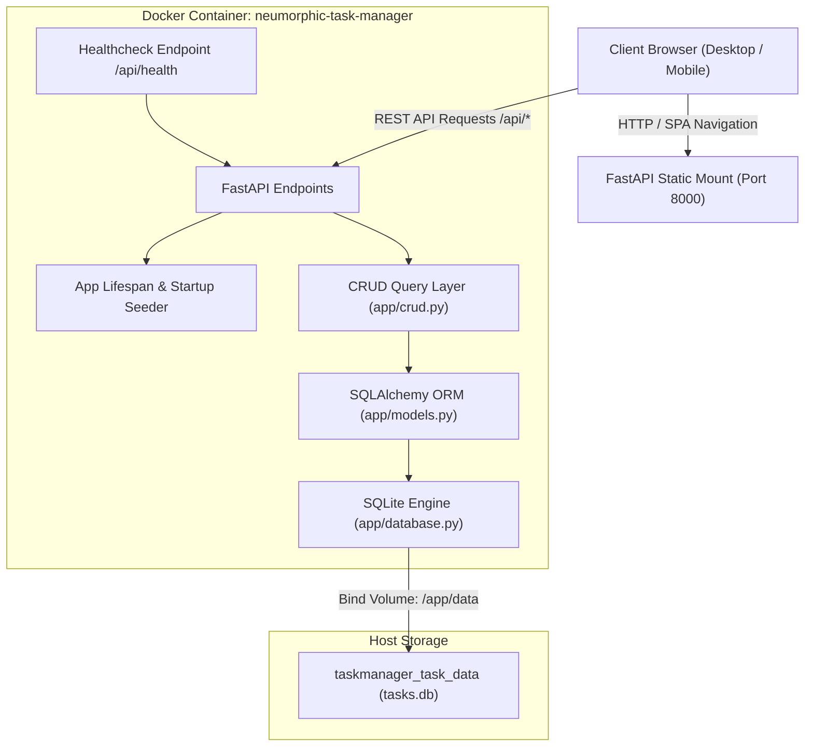
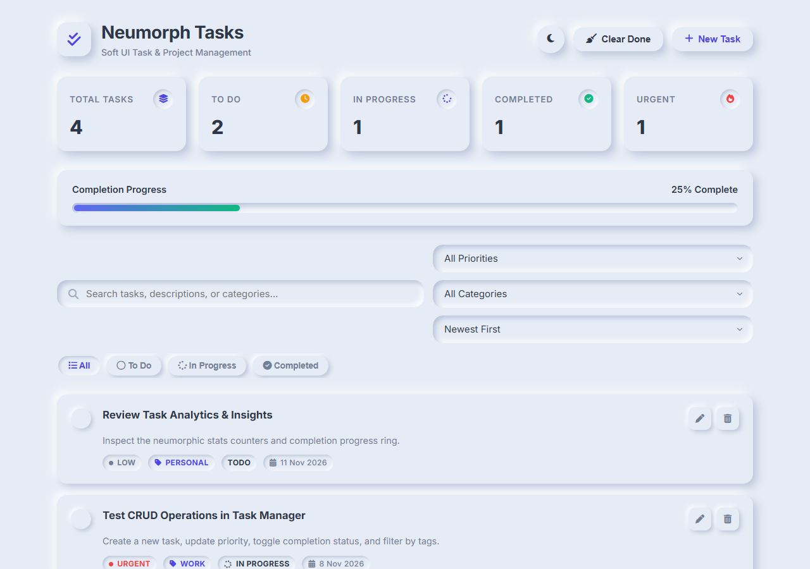
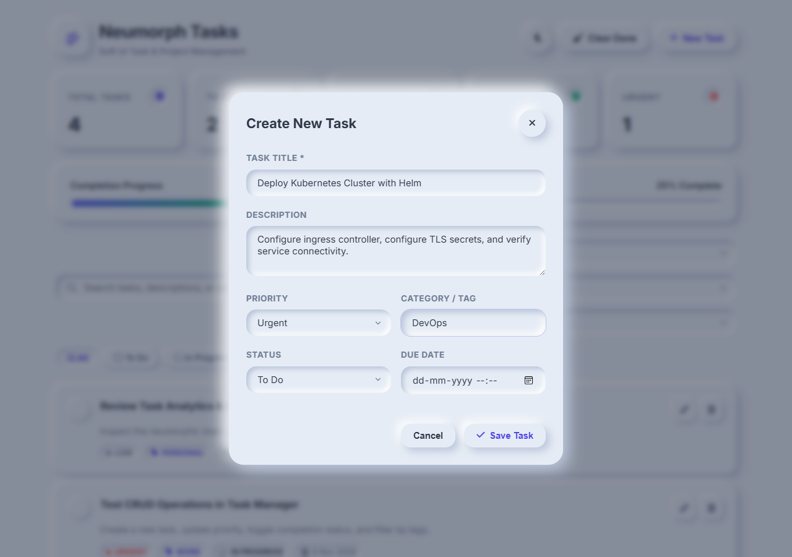
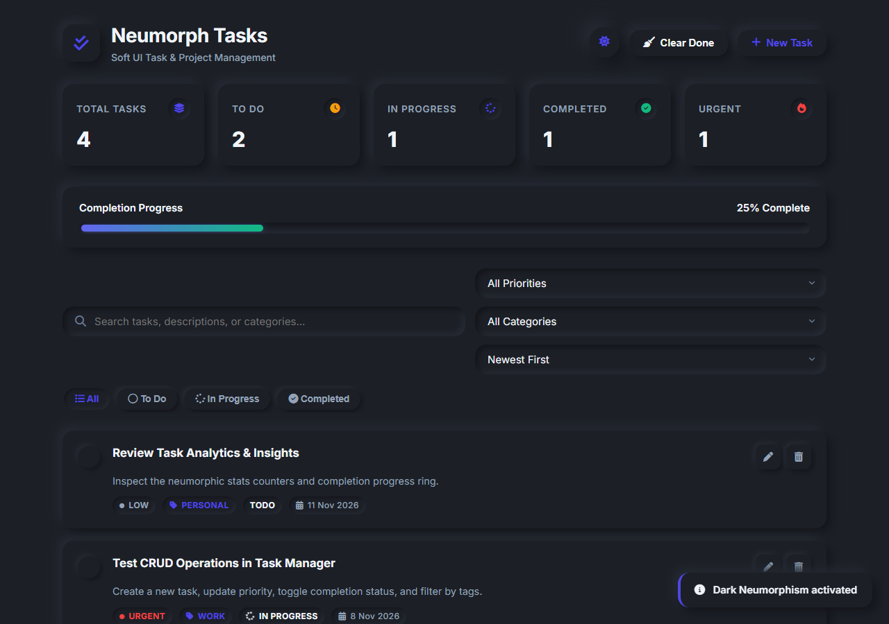
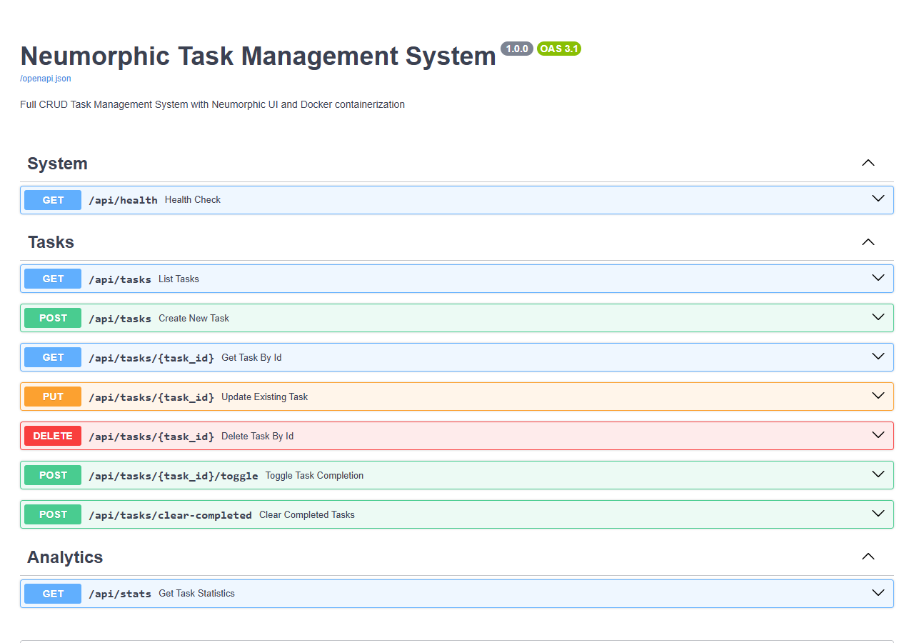
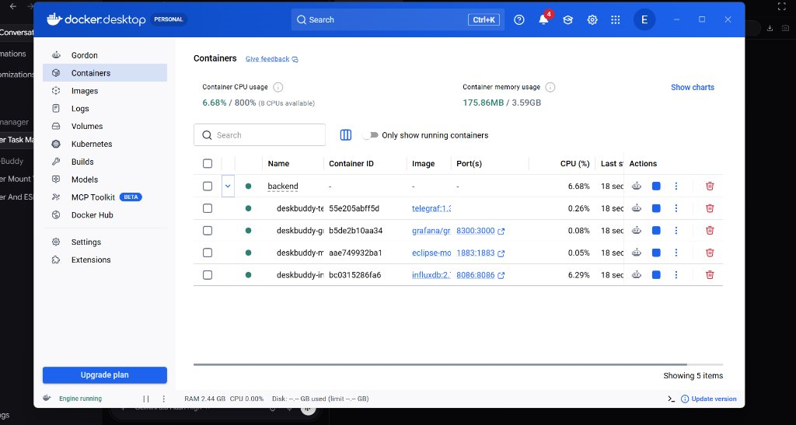
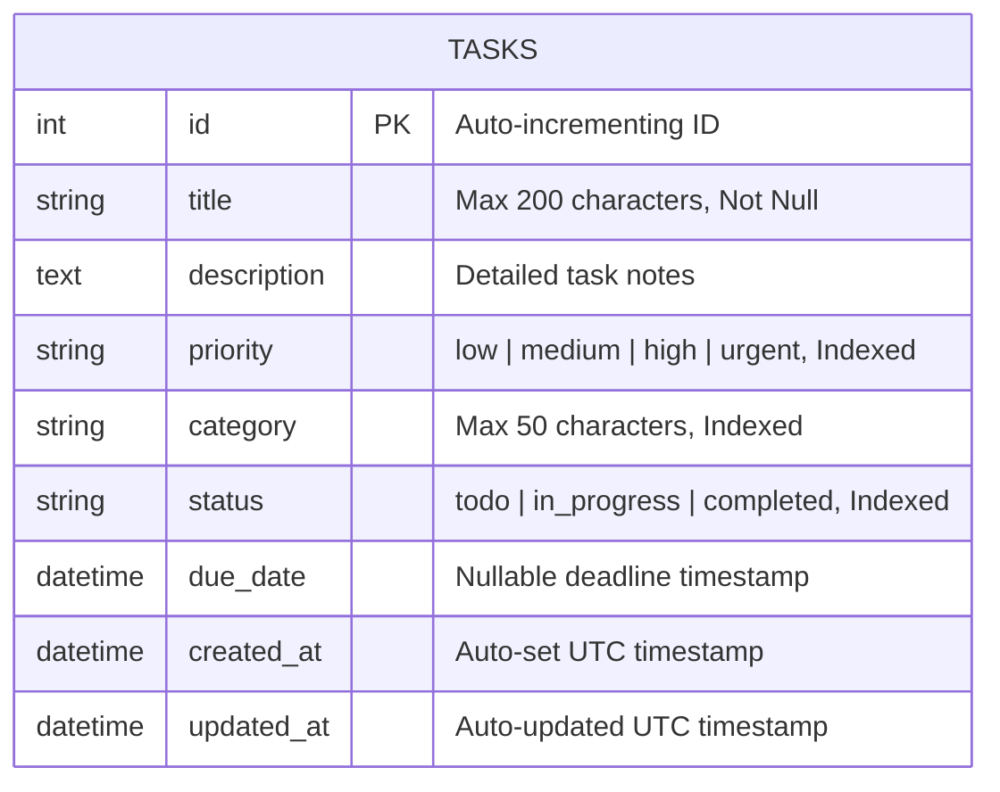

# 📖 Comprehensive Documentation: Neumorphic Task Management System

A full-stack, containerized task management platform featuring a complete CRUD workflow, persistent relational storage, and a pure Neumorphism (Soft UI) aesthetic with Light and Dark themes.

---

## 📑 Table of Contents
1. [System Architecture](#-system-architecture)
2. [Visual Tour & Essential Screenshots](#-visual-tour--essential-screenshots)
3. [Neumorphism Design System Specification](#-neumorphism-design-system-specification)
4. [Backend & REST API Reference](#-backend--rest-api-reference)
5. [Database Schema](#-database-schema)
6. [Docker Containerization & Persistence](#-docker-containerization--persistence)
7. [Step-by-Step User Guide](#-step-by-step-user-guide)
8. [Testing & Verification](#-testing--verification)

---

## 🏛 System Architecture

The application is architected as a lightweight, high-performance microservice containing a reactive SPA frontend and a FastAPI backend with SQLite volume persistence:



---

## 📸 Visual Tour & Essential Screenshots

### 1. Light Mode Neumorphic Dashboard
The main interface features soft ambient highlights and drop-shadows on an off-white background (`#e6ecf5`), live metric stat cards, and an interactive progress bar.



*Key Highlights:*
- **Stat Cards**: Real-time aggregation of Total, To Do, In Progress, Completed, and Urgent tasks.
- **Dynamic Progress Bar**: Smoothly animates based on completed tasks percentage.
- **Search & Filter Wells**: Debossed search bar with filter chips (`All`, `To Do`, `In Progress`, `Completed`), priority filters, category tags, and sorting options.

---

### 2. Task Creation & Modal Dialog
Clicking **"+ New Task"** or pressing `Ctrl + N` opens a recessed, extruded modal with debossed input wells.



*Form Fields:*
- **Title**: Mandatory task heading (up to 200 characters).
- **Description**: Optional multi-line notes or acceptance criteria.
- **Priority**: Categorized as `Low`, `Medium`, `High`, or `Urgent`.
- **Category / Tag**: Grouping tag (e.g., `DevOps`, `Work`, `Personal`, `Design`).
- **Status & Due Date**: Lifecycle stage and optional deadline.

---

### 3. Dark Mode Neumorphic Dashboard
A single click on the theme icon toggles the design system to charcoal soft UI (`#1c1f26`) with deep highlights and ambient shadows.



---

### 4. Interactive OpenAPI / Swagger Documentation
FastAPI automatically generates interactive Swagger documentation available at `/docs`, allowing developers to test API endpoints directly from the browser.



---

### 5. Docker Desktop Container Orchestration
The application is fully containerized and runs seamlessly with Docker Compose, providing automatic health status reporting and isolated storage.



---

## 🎨 Neumorphism Design System Specification

Neumorphism (Soft UI) creates a physical tactile illusion by pairing two opposing light sources on a monochromatic surface:

### 1. Dual-Shadow Mathematical Equation
- **Light Surface**: `#e6ecf5`
- **Highlight (Top-Left)**: Offset `(-6px, -6px)`, Color: `#ffffff`
- **Shadow (Bottom-Right)**: Offset `(+6px, +6px)`, Color: `#b8c4d9`

### 2. Core CSS Custom Tokens
```css
/* Light Neumorphism */
:root {
  --bg: #e6ecf5;
  --surface: #e6ecf5;
  --shadow-light: #ffffff;
  --shadow-dark: #b8c4d9;
  --neu-flat: 6px 6px 14px var(--shadow-dark), -6px -6px 14px var(--shadow-light);
  --neu-flat-lg: 10px 10px 24px var(--shadow-dark), -10px -10px 24px var(--shadow-light);
  --neu-pressed: inset 4px 4px 8px var(--shadow-dark), inset -4px -4px 8px var(--shadow-light);
}

/* Dark Neumorphism */
body.dark-theme {
  --bg: #1c1f26;
  --surface: #1c1f26;
  --shadow-light: #262b35;
  --shadow-dark: #121419;
  --neu-flat: 6px 6px 14px var(--shadow-dark), -6px -6px 14px var(--shadow-light);
  --neu-pressed: inset 4px 4px 8px var(--shadow-dark), inset -4px -4px 8px var(--shadow-light);
}
```

### 3. Element States
- **Extruded (Raised)**: Applied to cards, modal wrappers, and primary buttons using `--neu-flat`.
- **Debossed (Inset)**: Applied to inputs, dropdowns, and checkboxes using `--neu-pressed`.
- **Tactile Hover/Active**: Interactive buttons translate slightly downwards and switch to inset shadows upon clicking.

---

## 📡 Backend & REST API Reference

All API routes are served under `/api` and strictly validated using Pydantic schemas:

| HTTP Method | Route | Description | Success Code |
|---|---|---|---|
| `GET` | `/api/health` | Container healthcheck probe | `200 OK` |
| `GET` | `/api/tasks` | Filtered task list (`search`, `status`, `priority`, `category`, `sort_by`) | `200 OK` |
| `POST` | `/api/tasks` | Create a new task record | `201 Created` |
| `GET` | `/api/tasks/{id}` | Retrieve a single task by ID | `200 OK` |
| `PUT` | `/api/tasks/{id}` | Update existing task attributes | `200 OK` |
| `DELETE` | `/api/tasks/{id}` | Permanently delete a task | `204 No Content` |
| `POST` | `/api/tasks/{id}/toggle` | Toggle task status (`completed` <-> `todo`) | `200 OK` |
| `POST` | `/api/tasks/clear-completed` | Batch delete all completed tasks | `200 OK` |
| `GET` | `/api/stats` | Aggregated metrics & completion rate | `200 OK` |

### Sample cURL Request (Create Task)
```bash
curl -X 'POST' \
  'http://localhost:8000/api/tasks' \
  -H 'accept: application/json' \
  -H 'Content-Type: application/json' \
  -d '{
    "title": "Configure Prometheus metrics",
    "description": "Scrape task-manager endpoints and verify Grafana dashboards.",
    "priority": "high",
    "category": "DevOps",
    "status": "todo",
    "due_date": "2026-11-12T18:00:00Z"
  }'
```

---

## 🗄 Database Schema

The system uses an embedded SQLite database (`tasks.db`) handled through SQLAlchemy ORM:



---

## 🐳 Docker Containerization & Persistence

### Multi-Platform Dockerfile Breakdown
- **Base Image**: `python:3.11-slim` for minimal image footprint.
- **Healthcheck**: Uses `curl` to query `http://localhost:8000/api/health` every 30 seconds.
- **Volume**: Mounts `/app/data` to a persistent Docker named volume.

### One-Command Management
```bash
# Build and run containers in detached mode
docker compose up --build -d

# Inspect live application logs
docker compose logs -f

# Check container health status
docker ps --filter "name=neumorphic-task-manager"

# Gracefully stop the service
docker compose down
```

---

## ⌨️ Step-by-Step User Guide & Shortcuts

1. **Creating Tasks**:
   - Click the **"+ New Task"** button or press <kbd>Ctrl</kbd> + <kbd>N</kbd> (<kbd>Cmd</kbd> + <kbd>N</kbd> on macOS).
   - Enter your title and optional due date, then press <kbd>Enter</kbd> or click **"Save Task"**.
2. **Completing Tasks**:
   - Click the circular tactile checkbox on the left of any task card.
   - The card title receives a strike-through styling, the progress bar advances, and the Completed stat increments.
3. **Filtering & Searching**:
   - Type in the debossed search bar for instant debounced search (280ms threshold).
   - Switch status filter chips: *All*, *To Do*, *In Progress*, or *Completed*.
4. **Theme Switcher**:
   - Click the Moon/Sun button in the top header. Your preference is automatically stored in `localStorage`.
5. **Dismissing Modals**:
   - Press <kbd>Escape</kbd> or click anywhere on the blurred background overlay.

---

## 🧪 Testing & Verification

A dedicated verification suite is included to validate all CRUD endpoints and static assets:

```bash
# Run integration test suite using the project virtual environment
.\.venv\Scripts\python -c "
from fastapi.testclient import TestClient
from app.main import app

with TestClient(app) as client:
    assert client.get('/api/health').status_code == 200
    assert client.get('/api/tasks').status_code == 200
    assert client.get('/api/stats').status_code == 200
    assert client.get('/').status_code == 200
print('All core integration tests passed successfully!')
"
```
